<div align="center">

# CounterType

**A typing fighting game for the browser. Your keyboard is your weapon.**

Type faster and cleaner than your opponent to land hits, win races and pin arms to the table.

[Play in the browser](https://krytax-24.github.io/type-boxing/) · [Game modes](#game-modes) · [Controls](#controls) · [Online play](#online-play) · [Contributors](#contributors)

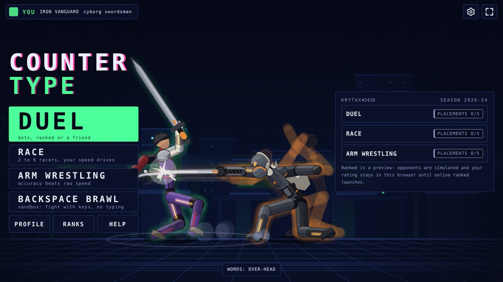

</div>

---

## Contents

1. [What is CounterType](#what-is-countertype)
2. [Play it now](#play-it-now)
3. [Game modes](#game-modes)
   - [Duel](#duel)
   - [Race](#race)
   - [Arm Wrestling](#arm-wrestling)
   - [Backspace Brawl](#backspace-brawl)
4. [Online play](#online-play)
5. [Ranked, profile and leaderboards](#ranked-profile-and-leaderboards)
6. [Fighters and the fighter creator](#fighters-and-the-fighter-creator)
7. [Stats](#stats)
8. [Themes and settings](#themes-and-settings)
9. [Controls](#controls)
10. [Accessibility](#accessibility)
11. [Under the hood](#under-the-hood)
12. [Working on the code](#working-on-the-code)
13. [Contributors](#contributors)
14. [Credits](#credits)

---

## What is CounterType

CounterType turns typing into a contest you can watch. Every correct key you press becomes power: a sword swing in a Duel, a few metres of track in a Race, a little more pressure on your opponent's hand in Arm Wrestling. Mistakes cost you, but never lock you out. The typing feels like Monkeytype (a wrong letter shows red, Backspace fixes it, the caret slides), and the action around it feels like a fighting game, with hit sparks, combos, counters and a gold ultimate.

- **Four modes**: Duel, Race, Arm Wrestling and Backspace Brawl, a fighting mode with no typing at all.
- **Play alone or with a friend**: bots at every skill level, practice dummies, private online rooms and a ranked preview.
- **Eleven designed fighters**, each with their own look, weapon and moves, plus a fighter creator.
- **Ten vehicles** to unlock in the Race, eight color themes and a full stats page.
- **No install, no account, no sign in.** Open the page and play. Settings, stats and your profile stay in your browser.

---

## Play it now

| Where                | How                                                                                                                                                                                        |
| -------------------- | ------------------------------------------------------------------------------------------------------------------------------------------------------------------------------------------ |
| **In the browser**   | Open [krytax-24.github.io/type-boxing](https://krytax-24.github.io/type-boxing/) (live once GitHub Pages is switched on for this repository).                                              |
| **On your computer** | Download this repository as a ZIP (**Code > Download ZIP**), unzip it and double click `index.html`. For online rooms, serve it over http: `npm start`, then open `http://localhost:8080`. |
| **On your own site** | Upload the files as they are to any static host (GitHub Pages, Cloudflare Pages, Netlify), or a joined, hashed copy made by `npm run build`.                                               |

Works in current versions of Chrome, Edge and Firefox on a desktop or laptop. On phones, Backspace Brawl is playable with touch controls; the typing modes need a physical keyboard.

---

## Game modes

### Duel

> Two typists, two fighters, one arena. Your typing speed is both your attack and your guard.

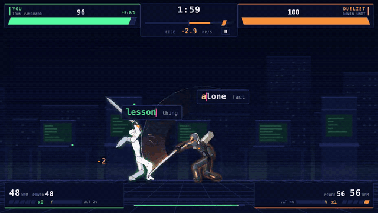

Each player types their own endless stream of words. The word you need to type floats in a plate over your fighter, and your opponent's word floats one row higher, so you can see every attack coming.

**How a Duel is won**

| Rule               | What it means                                                                                                                                                                                       |
| ------------------ | --------------------------------------------------------------------------------------------------------------------------------------------------------------------------------------------------- |
| **Speed is power** | Your power is your typing speed over the last few seconds. The faster typist deals damage; the gap decides how much.                                                                                |
| **Speed heals**    | Typing also heals you a little, but healing fades out as the fight goes on, so every fight ends.                                                                                                    |
| **Combos**         | Every clean word (no wrong key) adds to your combo and gives a small power boost. A mistake halves the combo.                                                                                       |
| **Counter**        | Break a long combo and your opponent gets a **COUNTER STRIKE**: instant damage and a short power boost.                                                                                             |
| **Ultimate**       | Fill the gold bar and build a combo of 10 clean words, and a hard gold word appears. Type it clean for 30 damage and a 2 second stun. One wrong key and it fires sloppy, for 12 damage and no stun. |
| **K.O.**           | First to 0 HP loses. With a round timer, the higher HP wins when time runs out.                                                                                                                     |

<table>
<tr>
<td width="50%">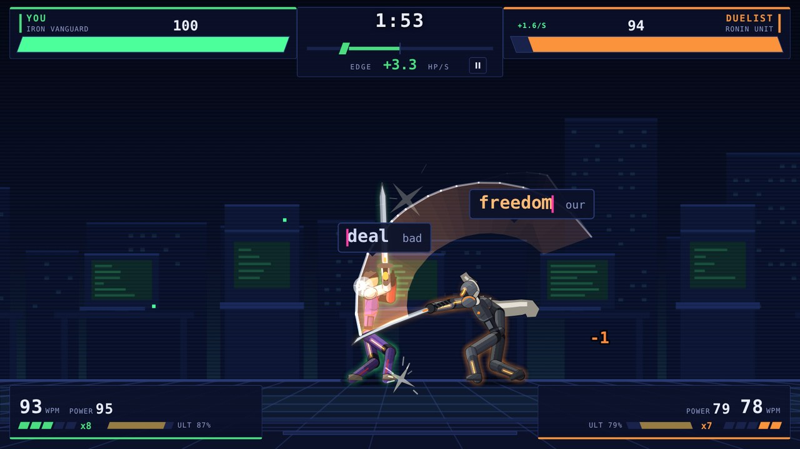<br><sub><b>Over-head view.</b> Words float above the fighters. Correct letters light up in your color, wrong ones turn red with a bar under them.</sub></td>
<td width="50%">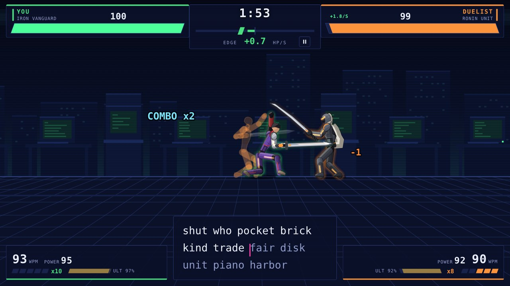<br><sub><b>Classic view.</b> A Monkeytype style typing box at the bottom, three lines at a time. Switch views in Settings or with F2.</sub></td>
</tr>
<tr>
<td width="50%">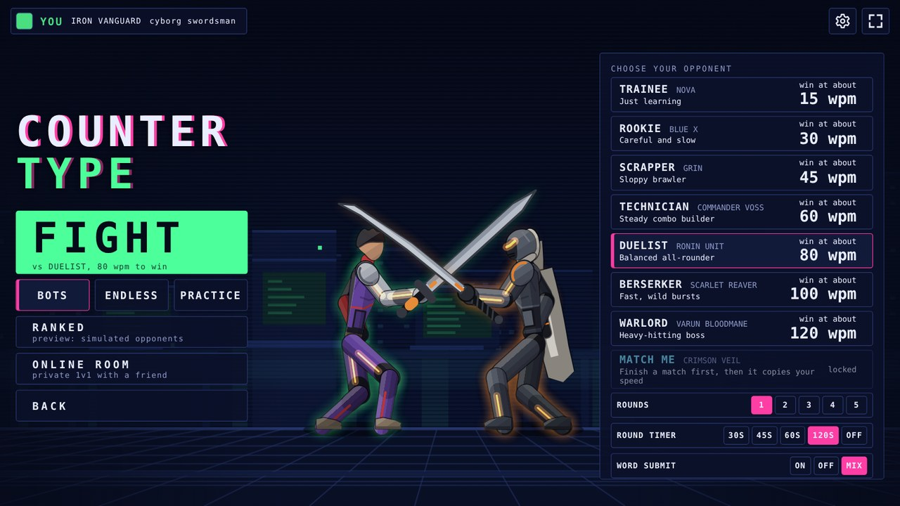<br><sub><b>Choose your opponent.</b> Seven bots from TRAINEE (15 wpm) to WARLORD (120 wpm), plus MATCH ME, which copies your own recent speed.</sub></td>
<td width="50%">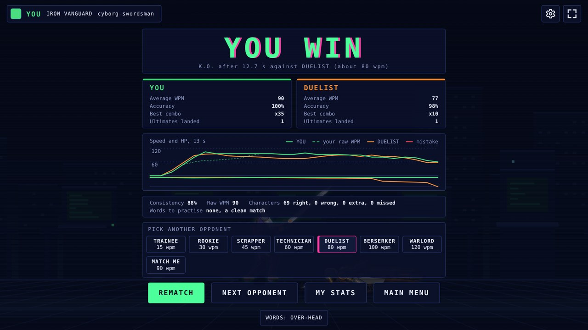<br><sub><b>Result.</b> Speed, accuracy, best combo, a second by second chart and the words worth practising.</sub></td>
</tr>
</table>

**Ways to play a Duel**

| Option          | What it is                                                                                                                                   |
| --------------- | -------------------------------------------------------------------------------------------------------------------------------------------- |
| **Bots**        | Eight opponents. The number on each card is the speed it really types at about 95% accuracy, so if you match it you win about half the time. |
| **Endless**     | Fight one bot with no timer and no rounds. Wins are tallied and a new fight starts after a short break.                                      |
| **Practice**    | Set up a dummy: its speed (0 or 15 to 120 wpm), its accuracy, and whether either of you can lose HP.                                         |
| **Ranked**      | A one round match against an opponent near your rating (see [Ranked](#ranked-profile-and-leaderboards)).                                     |
| **Online room** | A private 1v1 against a friend (see [Online play](#online-play)).                                                                            |

**Match rules**: best of 1 to 5 rounds, a round timer of 30, 45, 60 or 120 seconds (or none), and word submit **On** (press Space after each word), **Off** (a word ends by itself when it is exactly right) or **Mix** (each player uses their own setting).

| Opponent   | Style                | Speed                                               |
| ---------- | -------------------- | --------------------------------------------------- |
| TRAINEE    | Just learning        | 15 wpm                                              |
| ROOKIE     | Careful and slow     | 30 wpm                                              |
| SCRAPPER   | Sloppy brawler       | 45 wpm                                              |
| TECHNICIAN | Steady combo builder | 60 wpm                                              |
| DUELIST    | Balanced all-rounder | 80 wpm                                              |
| BERSERKER  | Fast, wild bursts    | 100 wpm                                             |
| WARLORD    | Heavy-hitting boss   | 120 wpm                                             |
| MATCH ME   | Your last 3 matches  | Your average speed (unlocks after your first match) |

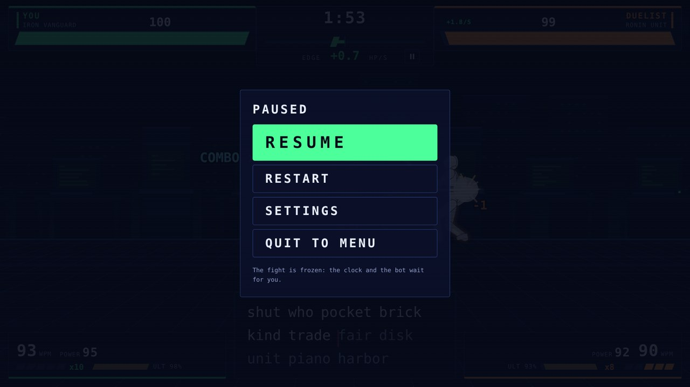 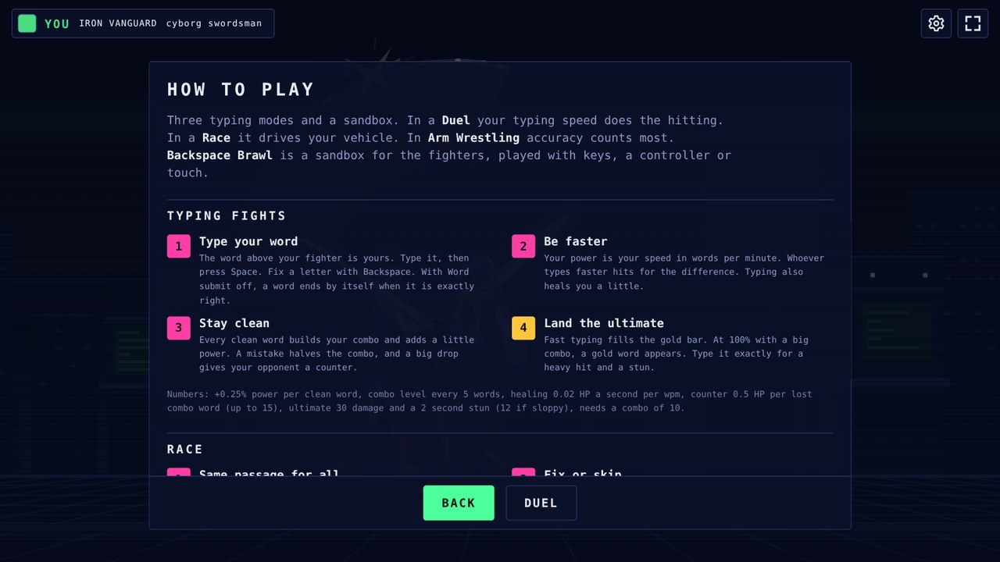

<sub>Esc pauses any fight and freezes the clock and the bot. How to play (H) explains every mode in short steps.</sub>

---

### Race

> 2 to 6 racers type the same passage. Your car or bike is exactly as far along the track as you have typed.

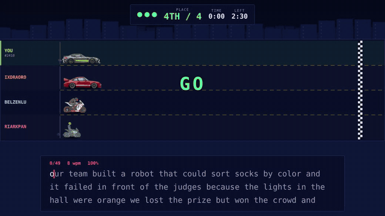

The Race types like Monkeytype. Letters go into the current word whether they are right or wrong, a wrong letter shows red, and Backspace fixes it. If you press **Space on a wrong word, you skip it** and carry on, but your time gets a penalty: **1 second plus 0.25 seconds for each wrong, missing or extra letter**. Fixing a typo is almost always faster than skipping it, so clean typing still wins.

Places go by **finish time plus penalties**, so a clean racer who crosses the line a moment later can still take first place.

<table>
<tr>
<td width="50%">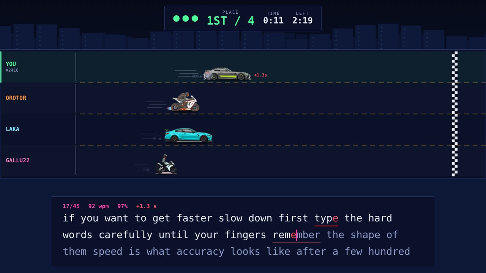<br><sub><b>Mid race.</b> The live line shows words done, speed, accuracy and any penalty. A skipped word stays underlined in red.</sub></td>
<td width="50%">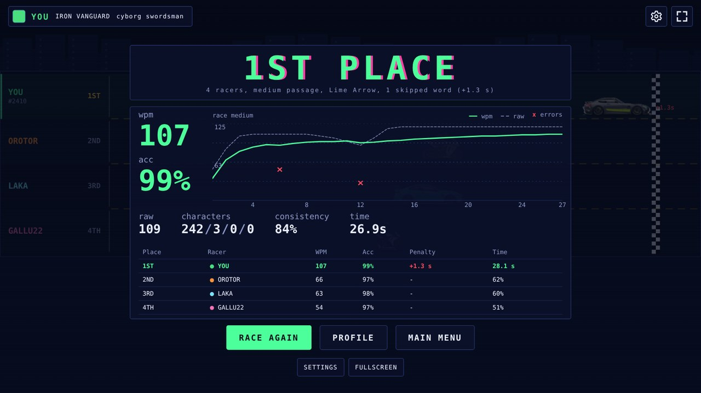<br><sub><b>Result.</b> Speed, accuracy, raw speed, characters, consistency, the chart, and the standings with a Penalty column.</sub></td>
</tr>
</table>

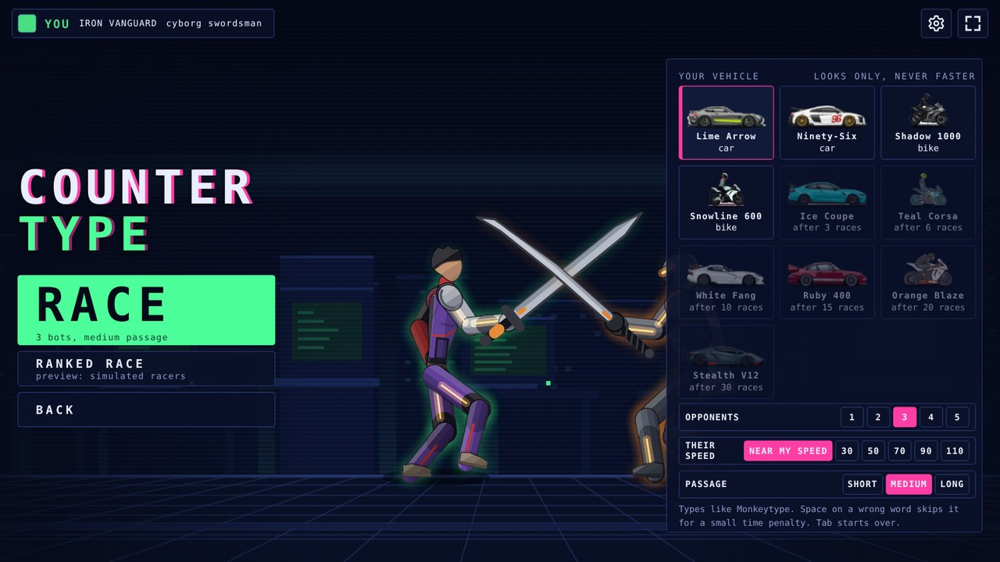

**Race options**

- **Opponents**: 1 to 5 bots. Their speed can be set **near your speed** (built from your recent races) or fixed at 30, 50, 70, 90 or 110 wpm. Bots make human mistakes: they notice a typo a letter or two late, pause, backspace and carry on.
- **Passage**: short, medium or long. Passages are original text in plain lower case words, with no punctuation to trip over.
- **Vehicles**: ten cars and bikes. Four are open from the start; the others unlock as you finish races (3, 6, 10, 15, 20 and 30 races). Vehicles are looks only and never make you faster.
- **Effects**: wheels spin and speed lines grow with your live speed, a typo makes your vehicle wobble and smoke, 10 clean words in a row fire a nitro boost (bikes pull a wheelie), and the finish line throws sparks.
- **Tab** starts a new race straight away in practice.

| Vehicle      | Type | Unlock   |
| ------------ | ---- | -------- |
| Lime Arrow   | Car  | Open     |
| Ninety-Six   | Car  | Open     |
| Shadow 1000  | Bike | Open     |
| Snowline 600 | Bike | Open     |
| Ice Coupe    | Car  | 3 races  |
| Teal Corsa   | Bike | 6 races  |
| White Fang   | Car  | 10 races |
| Ruby 400     | Car  | 15 races |
| Orange Blaze | Bike | 20 races |
| Stealth V12  | Car  | 30 races |

---

### Arm Wrestling

> Accuracy beats raw speed. Pin their hand, or be past the middle when the clock runs out.

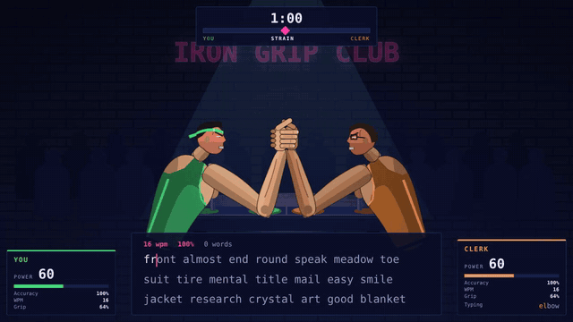

Both sides type their own stream of words while two wrestlers lock hands at a table in the IRON GRIP CLUB. Your power is **70% accuracy and 30% speed**, and your accuracy only counts in full while you keep up with at least 65% of your opponent's speed. The stronger side pushes the hands over. Reach the table and it is a pin. After 60 seconds, whoever is past the middle wins; a dead even match goes to 10 seconds of sudden death at double pull.

<table>
<tr>
<td width="50%">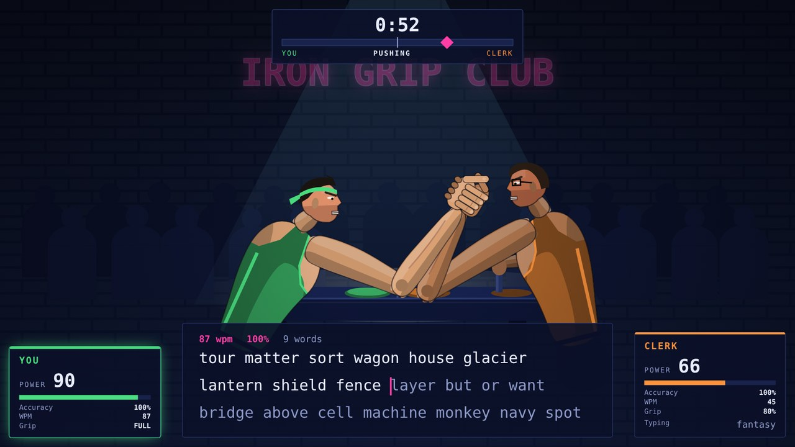<br><sub><b>Mid match.</b> The bar at the top shows where the hands are. Each side's power, accuracy, speed and grip sit in the corner panels.</sub></td>
<td width="50%">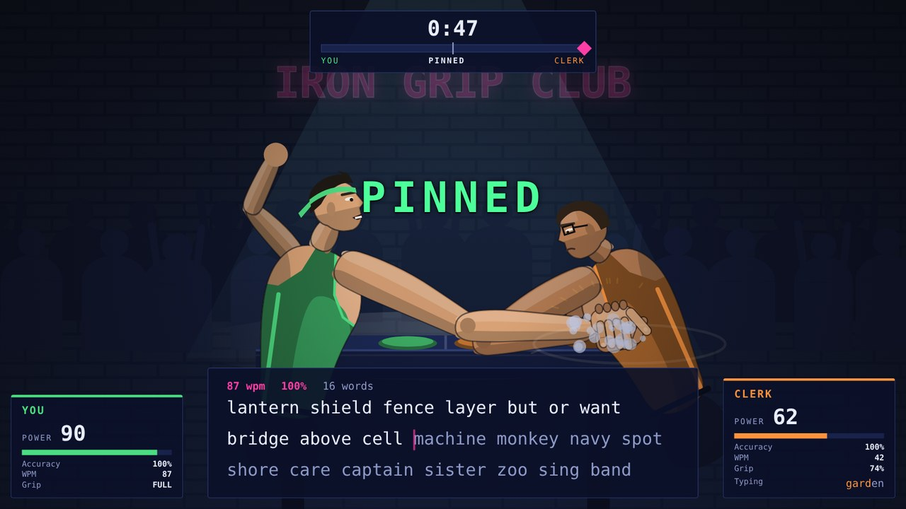<br><sub><b>The pin.</b> Hands slam into the table with a flash, dust and a crack left in the wood. The winner raises a fist.</sub></td>
</tr>
<tr>
<td width="50%">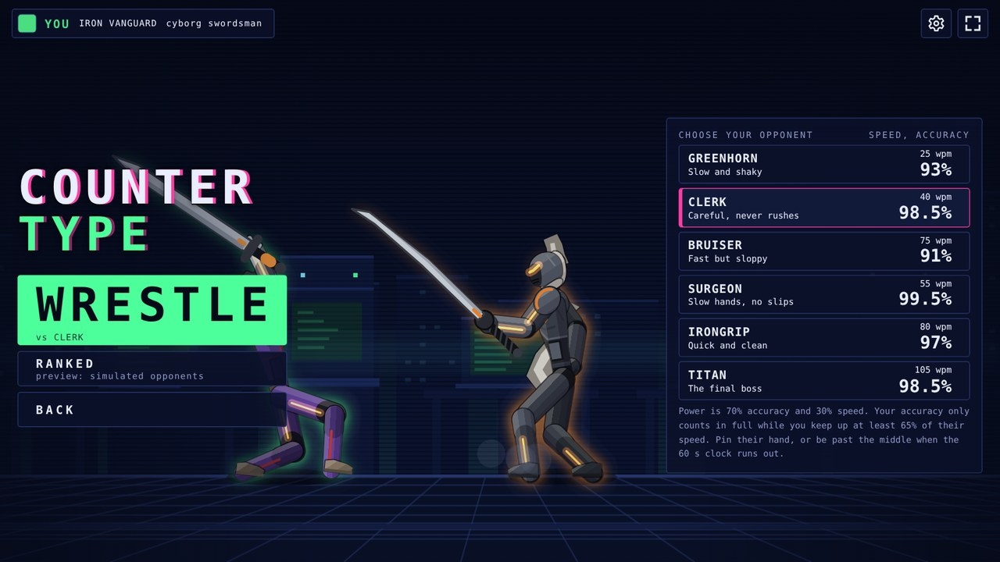<br><sub><b>Six opponents</b>, each with a different mix of speed and accuracy.</sub></td>
<td width="50%">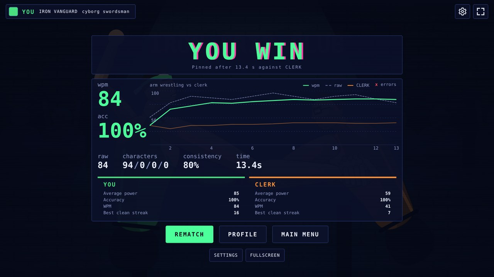<br><sub><b>Result.</b> The same detailed breakdown as the Race, with both wrestlers side by side.</sub></td>
</tr>
</table>

| Opponent  | Style                 | Speed   | Accuracy |
| --------- | --------------------- | ------- | -------- |
| GREENHORN | Slow and shaky        | 25 wpm  | 93%      |
| CLERK     | Careful, never rushes | 40 wpm  | 98.5%    |
| SURGEON   | Slow hands, no slips  | 55 wpm  | 99.5%    |
| BRUISER   | Fast but sloppy       | 75 wpm  | 91%      |
| IRONGRIP  | Quick and clean       | 80 wpm  | 97%      |
| TITAN     | The final boss        | 105 wpm | 98.5%    |

The match is drawn live: the hands follow a springy pull with a little overshoot, faces go red and veins show under strain, a typo jerks your hand back, and the crowd bobs with the tension and cheers at the end.

---

### Backspace Brawl

> A fighting mode with no typing at all. Punches, kicks, specials and finisher strings, against a bot or a friend online.

<table>
<tr>
<td width="50%">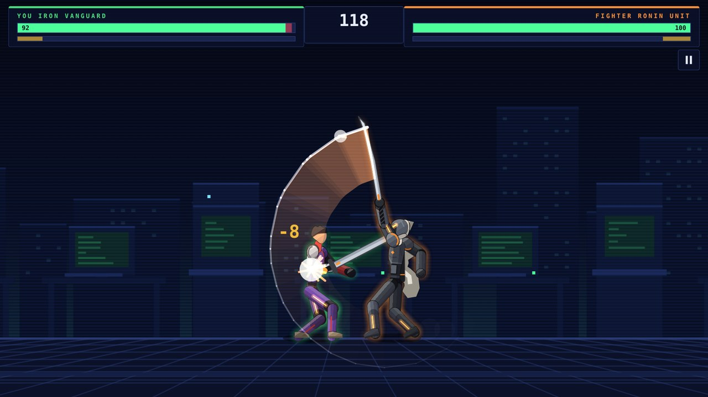<br><sub><b>The fight.</b> Health bars and the super meter on top, the round clock in the middle.</sub></td>
<td width="50%">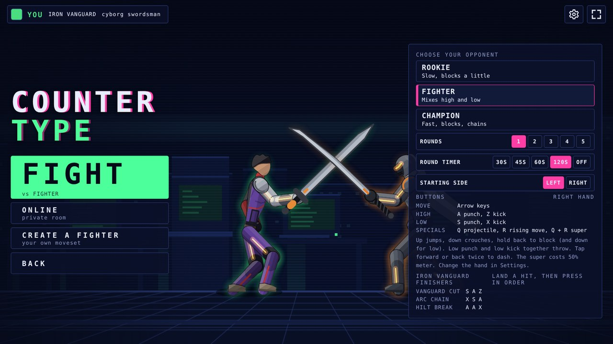<br><sub><b>The menu.</b> Three bots (ROOKIE, FIGHTER, CHAMPION), rounds, timer, starting side and the full move list with your fighter's finishers.</sub></td>
</tr>
</table>

- **Four attack buttons**: high punch, low punch, high kick, low kick. **Q** throws a projectile, **R** is a rising move, **Q + R** is the super (costs half the meter). Low punch and low kick together throw.
- **Movement**: up jumps, down crouches, hold back to block, double tap to dash. Classic motions (fireball, uppercut, super motion) work too.
- **Finishers**: every fighter has three named three-button strings. Land a hit, then press the string to chain into it.
- **Left-handed layout** in Settings, and gamepads work.
- **Phones**: the only mode that plays on a phone, in portrait or landscape, with a touch pad on one side and the attack buttons on the other.

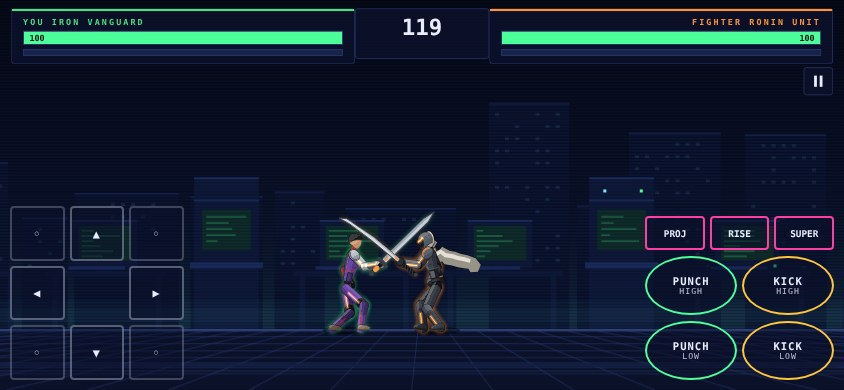

---

## Online play

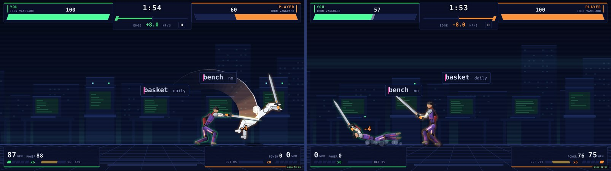

<sub>One online Duel seen from both sides at once: the host on the left, the guest on the right. Each player sees themselves as YOU.</sub>

Play a Duel or a Backspace Brawl against a friend in a private room.

1. Open the game from a web address (http or https). Online play does not work from a file opened by double click.
2. One player picks **Duel**, then **Online room**, then **Create room**, and shares the short room code or the invite link.
3. The other player enters the code (or opens the link) and joins. Both press **Ready**. The host's match rules apply.

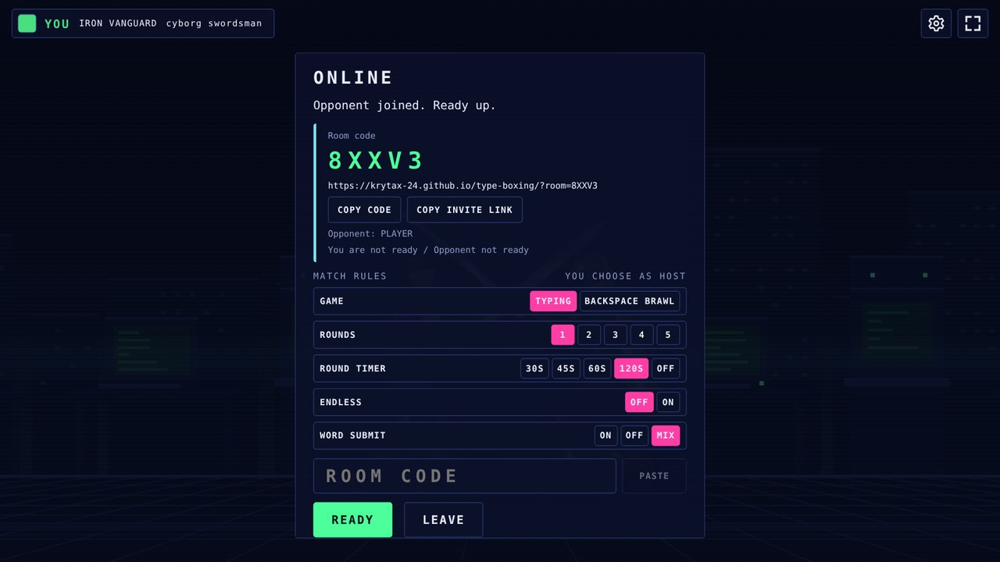

- **Private and peer to peer**: the two browsers talk to each other directly. A small matchmaking server only introduces them; no game data passes through it.
- **Fair**: the host judges the fight and the guest's keys are sent the moment they are pressed. A small ping badge shows the connection (green under 80 ms, amber under 160).
- **Rematch** from the result screen without leaving the room.
- **Strict networks**: this public build connects players directly (STUN only) and has no relay server, so some offices, schools and mobile carriers may block the connection.
- Online matches are unranked and are not saved to your stats.

---

## Ranked, profile and leaderboards

> Ranked is a **preview**. Opponents are simulated and your rating is kept in your browser until online ranked launches.

<table>
<tr>
<td width="50%">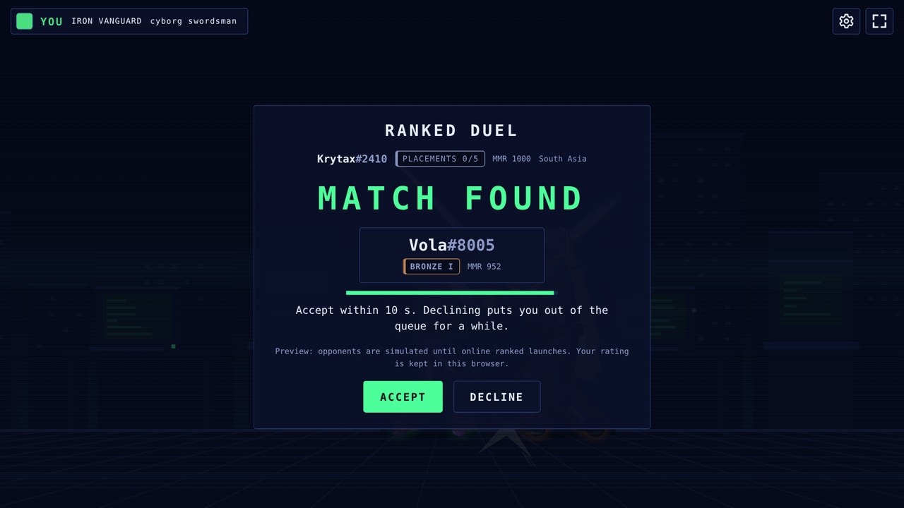<br><sub><b>Queue.</b> The search starts close to your rating and widens over time. Accept within 10 seconds; declining puts you out of the queue for a while.</sub></td>
<td width="50%">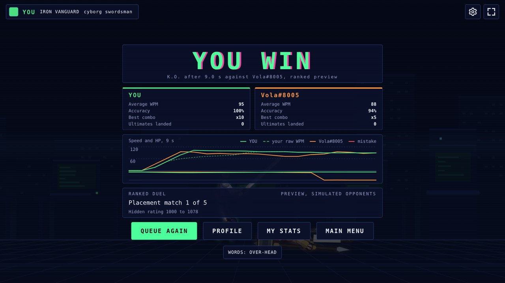<br><sub><b>Ranked result.</b> Placement progress, rating change and tier.</sub></td>
</tr>
<tr>
<td width="50%">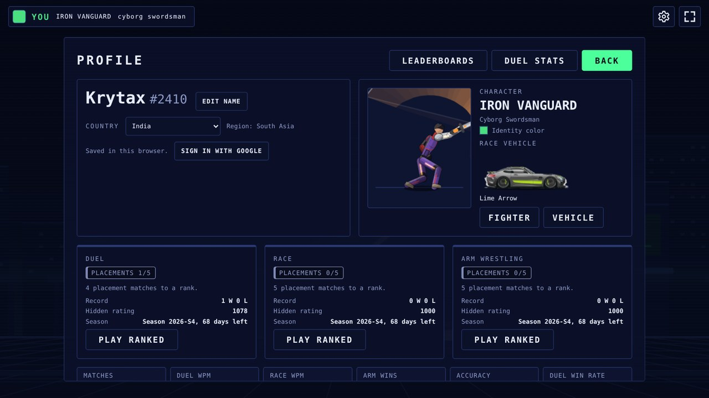<br><sub><b>Profile.</b> Your Name#1234 tag, country and region, fighter, vehicle, and your rank in each mode.</sub></td>
<td width="50%">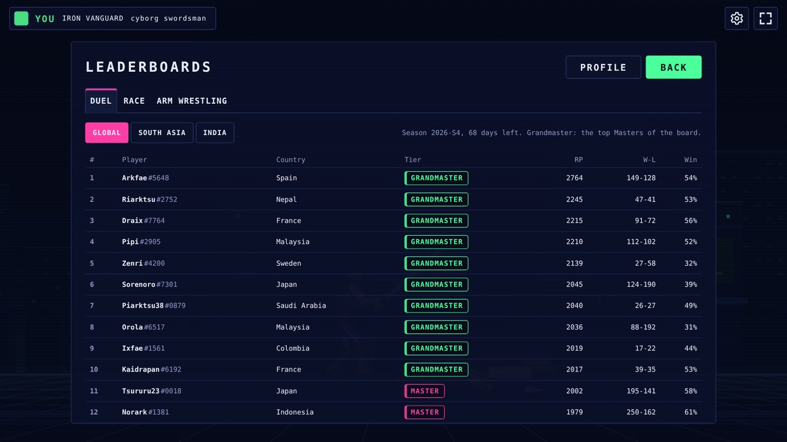<br><sub><b>Leaderboards.</b> Global, regional and country boards for each ranked mode.</sub></td>
</tr>
</table>

- **Ranked modes**: Duel, Race and Arm Wrestling, each with its own rating.
- **Tiers**: Bronze, Silver, Gold, Platinum and Diamond (each with divisions III, II and I), then Master, and Grandmaster for the top Masters of the board.
- **Placements**: 5 placement matches before your first rank (3 after a season reset). A 3 match promotion shield stops you dropping straight back down.
- **Seasons** follow the calendar quarters, with a soft reset at the start of each one. Diamond and above slowly lose points after two idle weeks.
- **Fair pairing**: ranked never pairs players who use different word submit settings.
- **Your name**: 3 to 16 letters, digits, spaces or underscores, with a random four digit tag. You can change it once every 30 days.

---

## Fighters and the fighter creator

<table>
<tr>
<td width="50%">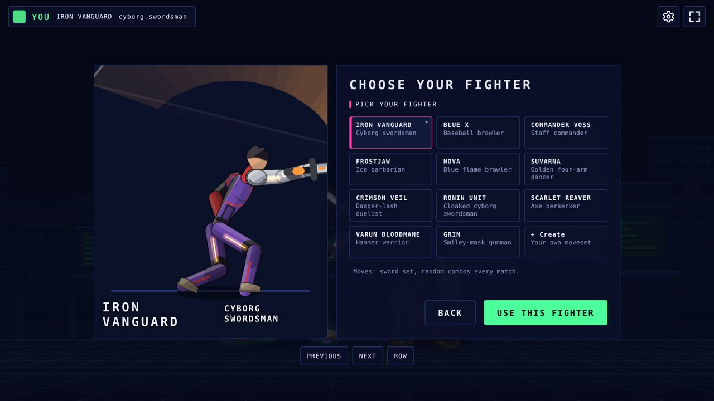<br><sub><b>Choose your fighter.</b> Eleven designed fighters, each with their own costume, weapon and move set. Fighters are looks only in the typing modes and never change a number.</sub></td>
<td width="50%">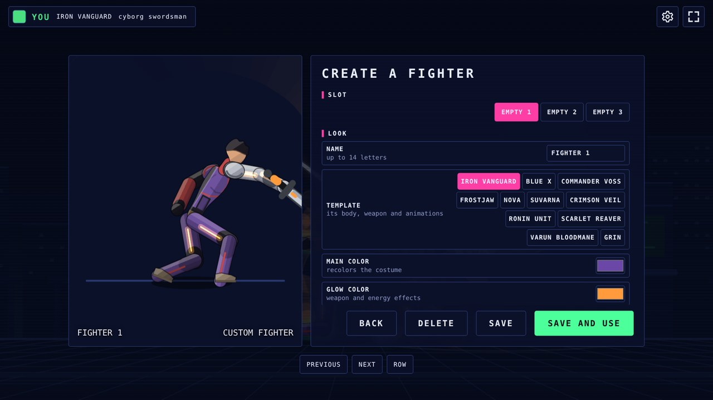<br><sub><b>Create a fighter.</b> Three slots. Pick a template, a name, a main and a glow color, which animation each button plays, three named finishers, and spend 9 stat points on power, speed and reach.</sub></td>
</tr>
</table>

The roster: **Iron Vanguard** (cyborg swordsman), **Blue X** (baseball brawler), **Commander Voss** (staff commander), **Frostjaw** (ice barbarian), **Nova** (blue flame brawler), **Suvarna** (golden four-arm dancer), **Crimson Veil** (dagger-lash duelist), **Ronin Unit** (cloaked cyborg swordsman), **Scarlet Reaver** (axe berserker), **Varun Bloodmane** (hammer warrior) and **Grin** (smiley-mask gunman).

Every fighter is drawn and animated in code: a jointed rig with eased keyframes, two-bone leg IK so feet never slide, cloth that swings, and shading from a single light. Custom fighters use a points budget, so a custom fighter is never stronger than a designed one. Online, a custom fighter plays as its template so both players see the same fight.

---

## Stats

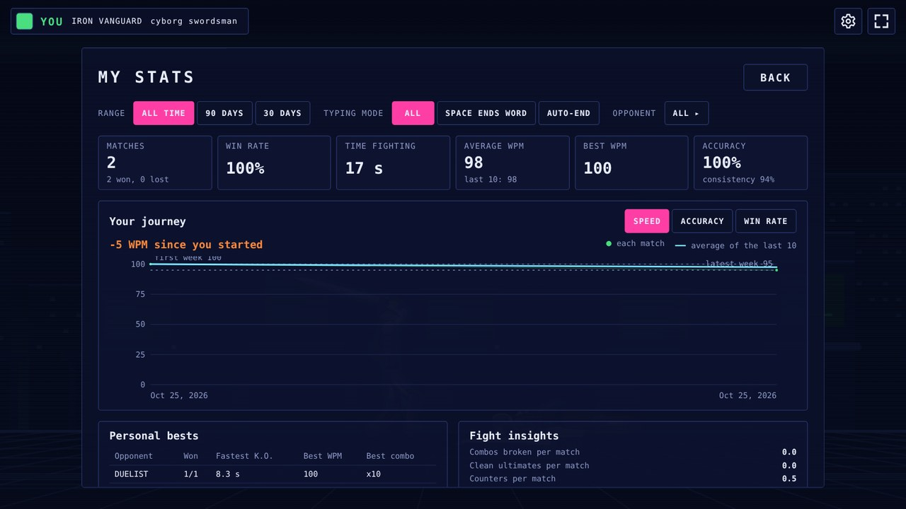

**My stats** (from your Profile or any result screen) keeps your match history in your browser:

- Totals: matches, win rate, time fighting, average and best speed, accuracy and consistency.
- **Your journey**: speed, accuracy or win rate over time, with each match as a point and a running average.
- Filters by time range (all time, 90 days, 30 days), typing mode and opponent.
- **Personal bests** against each opponent and **fight insights** (combos broken, clean ultimates and counters per match).

---

## Themes and settings

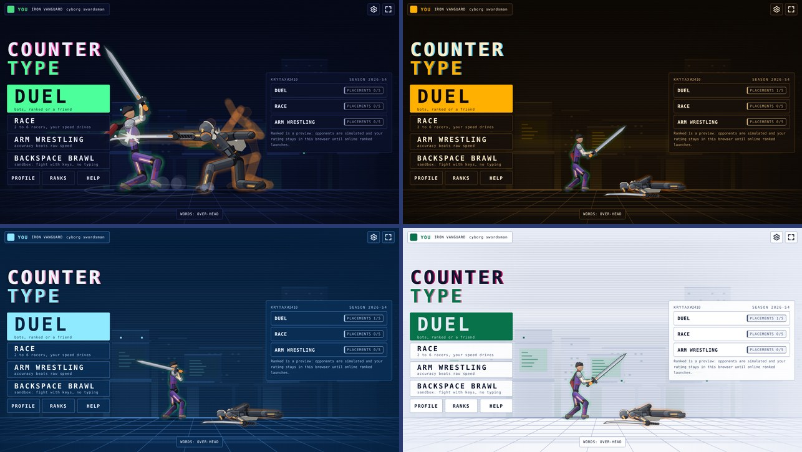

<sub>Terminal Arcade (the original), Amber CRT, Blueprint and Daylight.</sub>

The default look is **Terminal Arcade**: a retro computer lab and arcade world in deep navy, phosphor green and hot magenta, with gold kept for the ultimate. Seven more themes are built in: **Amber CRT**, **Blueprint**, **Moss Console**, **Midnight Violet**, **Graphite**, **High Contrast** and **Daylight** (a light theme). You can recolor any of them slot by slot and share the result as a short code, and the Custom tab takes a background image of your own and custom CSS.

<table>
<tr>
<td width="50%">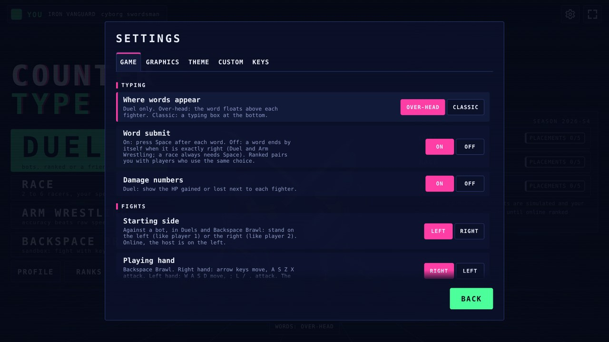<br><sub><b>Game</b>: where words appear, word submit, damage numbers, starting side, playing hand, volume.</sub></td>
<td width="50%">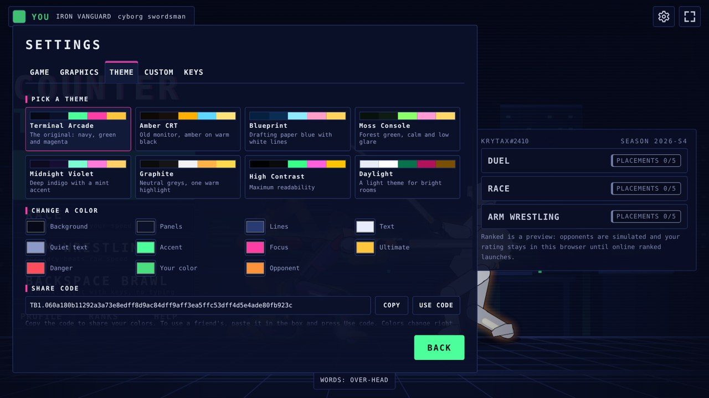<br><sub><b>Theme</b>: eight presets, eleven color slots and a share code.</sub></td>
</tr>
</table>

| Tab          | What you can change                                                                                                                                                                                                   |
| ------------ | --------------------------------------------------------------------------------------------------------------------------------------------------------------------------------------------------------------------- |
| **Game**     | Over-head or Classic view, word submit on or off, damage numbers, starting side (left or right), playing hand for Backspace Brawl, sound volume.                                                                      |
| **Graphics** | Quality preset (Low, Medium, High), render scale, background scenery (full, simple, off), frame rate limit, FPS counter, effect limit, reduce motion, screen shake strength, fullscreen, interface size, HUD opacity. |
| **Theme**    | Eight presets, eleven color slots, share codes.                                                                                                                                                                       |
| **Custom**   | A background image (a link or a file from your computer) and custom CSS.                                                                                                                                              |
| **Keys**     | Every key in every mode, in one list.                                                                                                                                                                                 |

---

## Controls

Every action has a key **and** a button. Clicking a button never takes focus away from your typing.

| Where                           | Keys                                                                                                                                                           |
| ------------------------------- | -------------------------------------------------------------------------------------------------------------------------------------------------------------- |
| **Home**                        | **Enter** Duel, **R** Race, **A** Arm Wrestling, **B** Backspace Brawl, **P** Profile, **L** Leaderboards, **H** How to play, **S** Settings, **F** Fullscreen |
| **Duel menu**                   | **Enter** Fight, **B** Bots, **E** Endless, **P** Practice, **K** Ranked, **O** Online room, **1** to **8** pick an opponent, **C** Fighter                    |
| **Typing**                      | Letters type, **Space** ends a word, **Backspace** fixes a letter, **Ctrl + Backspace** clears the whole word                                                  |
| **Duel**                        | **F2** switches between Over-head and Classic view                                                                                                             |
| **Race and Arm Wrestling**      | **Tab** starts a new race or match (practice only); **Tab** or **Enter** on the result starts the next one                                                     |
| **Any fight**                   | **Esc** pauses (leaving the tab or window pauses too). In the pause menu: **Enter** resume, **R** restart, **S** settings, **Q** quit                          |
| **Backspace Brawl, right hand** | Arrow keys move, **A** high punch, **S** low punch, **Z** high kick, **X** low kick, **Q** projectile, **R** rising move, **Q + R** super                      |
| **Backspace Brawl, left hand**  | **W A S D** move, **;** high punch, **L** low punch, **/** high kick, **.** low kick, **P** projectile, **O** rising move, **P + O** super                     |

---

## Accessibility

- **Reduce motion**: one switch turns off screen shake, flashes, hit-stop and animations. It is on by default when your system asks for reduced motion.
- **Color is never the only cue**: every wrong letter also gets a bar under it, and the caret changes color when it would be too close to your letter color.
- **Contrast**: the default theme's text colors are all at least 4.5:1 against their backgrounds, and every built-in theme keeps its main text at 4.5:1 or better. High Contrast and Daylight themes are included.
- **Interface size** and **HUD opacity** settings, and a screen that scales from small laptops to ultrawide monitors.
- **Keyboard only or mouse only**: every screen works either way.
- **Left-handed** key layout and mirrored touch controls for Backspace Brawl.

---

## Under the hood

CounterType is built with **plain HTML, CSS and JavaScript**: no framework, no build step needed to run it, and no library except [PeerJS](https://peerjs.com) for online rooms. The arena is drawn on a canvas; the HUD, menus and typing box are HTML on top of it.

<details>
<summary><b>How the code is organised</b></summary>

<br>

Every file is one small module with a written list of the modules it uses (`CounterType.define(id, dependencies, factory)`), and the only global is `CounterType`. Modules sit in layers that only depend downward, so a change can only reach the modules that list it. Game rules never touch the screen, the clock or `Math.random`, so they can be tested on their own.

```
src/kernel/         the module system, the event bus, the registry of extension points
src/core/           numbers (config), randomness, words, storage, themes, sound
src/engine/         the Duel rules, the typing engine and the fighters (rig, motion, clips, characters, renderer)
src/services/       settings, your fighter, stats, ratings, profile, the backend stand-in
src/ui/             the UI kit every screen uses
src/app/            the shell: router, modals, actions, session, layout, arena, keyboard, main loop
src/pages/          one folder per screen or modal: home, how to play, fighter, creator, stats, profile, ...
src/modes/duel/     the Duel: session, HUD, input, menu, bots, practice, result         (plug-in)
src/modes/race/     Race rules, passages, vehicles, track and screens                     (plug-in)
src/modes/arm/      Arm Wrestling rules, the wrestling scene and screens                  (plug-in)
src/modes/brawl/    Backspace Brawl rules, input (keys, gamepad, touch) and screens       (plug-in)
src/net/            online rooms: the message format, the connection, the room screen     (plug-in)
```

- **Plug and play**: each mode and the online layer is one block in `index.html` and never depends on another plug-in. Delete a block, switch it off with `index.html?disable=race`, or leave it out of a build with `node tools/build.js --without race`; the menus, How to play, the keys table and the profile adapt by themselves.
- **Deterministic rules**: the Duel runs on a fixed 1/120 second step from a shared seed and never reads real time, which is what makes host-judged online play and repeatable tests possible.
- **Tested**: 9 headless suites (445 checks) cover the module system, the structure rules, every mode's rules, the online messages and ranked, and 25 recorded matches must replay exactly. Each bot is calibrated so the speed on its card is the speed it really types.
- **Fast**: scenery is painted once into offscreen layers and slid for parallax, and vehicles are cached sprites.

</details>

---

## Working on the code

The game needs nothing installed. The development tools need [Node.js](https://nodejs.org) 18 or newer:

```
npm install            ESLint and Prettier (dev only; the game itself has no dependencies)
npm test               every test suite          npm run test:quick   the rule checks only, a few seconds
npm run lint           ESLint                    npm run format       Prettier
npm run health         the full health check (tests, lint, format, and browser checks when Playwright is installed)
npm run build          a joined, hashed production copy in dist/ (node tools/build.js --without race leaves plug-ins out)
npm run bump           new cache tags (?v=) on every file in index.html, so browsers load a new delivery
```

- **Relay keys**: online rooms work on direct connections. For relay (TURN) servers, copy `src/net/net-keys.example.js` to `src/net/net-keys.js` and fill in your keys; that file stays out of git.
- **Before calling a change done**: `npm run test:quick`, `npm run lint`, `npm run format:check`, and `npm run health` for anything that touches the page.
- **Read more**: [ARCHITECTURE.md](ARCHITECTURE.md) (layers, module contracts, events, recipes for adding or removing a part), [HEALTH-REPORT.md](HEALTH-REPORT.md) (the code audit and how v2 was verified), [CHANGELOG.md](CHANGELOG.md).

<details>
<summary><b>Moving from the October 2026 layout</b></summary>

<br>

| Before (js/, css/)                                                                                        | Now (src/)                                                                                                                                                                                                                                                                                                                                                                         |
| --------------------------------------------------------------------------------------------------------- | ---------------------------------------------------------------------------------------------------------------------------------------------------------------------------------------------------------------------------------------------------------------------------------------------------------------------------------------------------------------------------------- |
| `core/app.js` (registry and events)                                                                       | `kernel/kernel.js`, `kernel/registry.js`, `kernel/events.js`                                                                                                                                                                                                                                                                                                                       |
| `core/config.js`                                                                                          | `core/config.js`, plus `race-config.js`, `arm-config.js`, `brawl-config.js`, `net-config.js` in their plug-ins                                                                                                                                                                                                                                                                     |
| `core/sfx.js`                                                                                             | `core/audio.js` (and `app/sound.js` applies the sound settings)                                                                                                                                                                                                                                                                                                                    |
| `engine/modes.js`, `engine/duel-typing.js`, `engine/render.js`                                            | `engine/match-rules.js`, `engine/typing.js`, `engine/renderer.js`                                                                                                                                                                                                                                                                                                                  |
| `engine/anim-rig.js`, `anim-move.js`, `anim-clips.js`, `anim-chars.js`, `anim-combos.js`, `duel-chars.js` | `engine/animation/rig.js`, `motion.js`, `clips.js`, `characters.js`, `combos.js`, `fighter-stage.js`                                                                                                                                                                                                                                                                               |
| `app/*.js` (the shell: 10 files, about 1,700 dense lines sharing about 75 global variables)               | `app/` (router, modals, actions, session, layout, arena, looks, keyboard, loop, backdrop, topbar, theme tokens, sound, online gateway), `pages/` (home, how to play, fighter, settings, pause, confirm), `modes/duel/` (the Duel's flow, HUD, menu, input, result), `services/settings.js`, `player.js`, `speed-history.js`, `ui/` (buttons, option rows, key line, toast, banner) |
| `ui/mtype.js`                                                                                             | `ui/type-view.js` and `ui/type-result.js`                                                                                                                                                                                                                                                                                                                                          |
| `ui/mode-ui.js`                                                                                           | `pages/mode-result/mode-result-page.js` and `pages/queue/queue-page.js`                                                                                                                                                                                                                                                                                                            |
| `ui/stats-page.js`, `profile-page.js`, `leaderboard-page.js`                                              | `pages/stats/` (with `stats-charts.js`), `pages/profile/`, `pages/leaderboard/`                                                                                                                                                                                                                                                                                                    |
| `ui/creator.js`                                                                                           | `services/creator.js` (your fighters' data) and `pages/creator/creator-page.js` (the screen)                                                                                                                                                                                                                                                                                       |
| `modes/race/race.js`, `passages.js`, `vehicles.js`, `vehicle-art.js`, `race-game.js`                      | `modes/race/race-rules.js`, `race-passages.js`, `race-vehicles.js`, `race-vehicle-art.js`, and `race-mode.js` with `race-hud.js`, `race-menu.js`, `race-track.js`, `race-result.js`, `race-records.js`                                                                                                                                                                             |
| `modes/arm/armwrestle.js`, `arm-scene.js`, `arm-game.js`                                                  | `modes/arm/arm-rules.js`, `arm-scene.js`, and `arm-mode.js` with `arm-hud.js`, `arm-menu.js`, `arm-result.js`, `arm-records.js`                                                                                                                                                                                                                                                    |
| `modes/brawl/brawl.js`, `brawl-input.js`, `brawl-game.js`                                                 | `modes/brawl/brawl-rules.js`, `brawl-input.js`, `brawl-touch.js`, and `brawl-mode.js` with `brawl-hud.js`, `brawl-menu.js`, `brawl-fx.js`, `brawl-result-page.js`, `brawl-custom.js`                                                                                                                                                                                               |
| `net/protocol.js`, `net.js`, `online.js`                                                                  | `net/net-protocol.js`, `net-peer.js`, `net-online.js` and `net-room-page.js` (the Duel's own online part is `modes/duel/duel-online.js`)                                                                                                                                                                                                                                           |
| `css/core.css`, `css/ui/*.css`, `css/modes/*.css`, `css/net.css`                                          | one stylesheet next to each component                                                                                                                                                                                                                                                                                                                                              |
| `tools/release.js`, `tests/load.js`                                                                       | `tools/build.js`, `tests/support/loader.js`                                                                                                                                                                                                                                                                                                                                        |

Saved data (settings, records, profile, custom fighters, themes) keeps the same browser storage keys, so nothing is lost when you switch.

</details>

---

## Contributors

CounterType is made by:

- **Krishna** ([Krytax-24](https://github.com/Krytax-24))
- **Roni Pal**

---

## Credits

- The typing feel is inspired by [Monkeytype](https://monkeytype.com).
- The idea of a typing beat 'em up was inspired by "Keyboard Warrior Stickman"; no art, characters, names or music were copied from it.
- The fighters, the arena, the arm wrestlers and the club are original, drawn in code.
- The race car and bike pictures are illustrations collected for this prototype; their artists keep the rights. Replace or license them before a public launch.
- Online rooms use [PeerJS](https://peerjs.com) (MIT license, `src/vendor/peerjs.LICENSE.txt`).

<div align="center">
<br>
<sub>Made with a keyboard, for keyboards.</sub>
</div>
