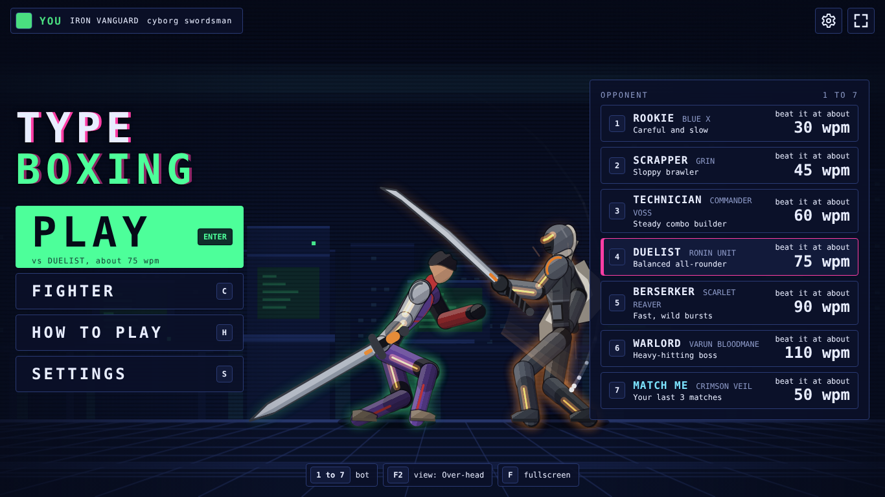
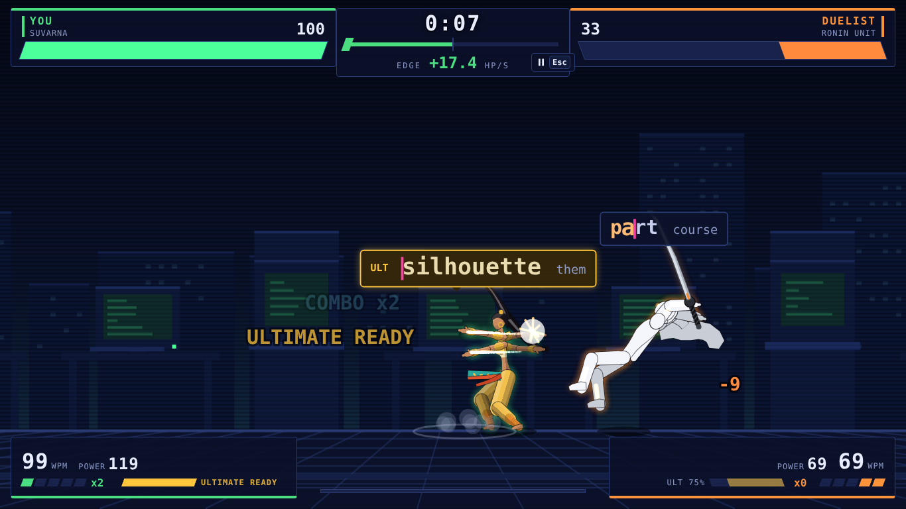
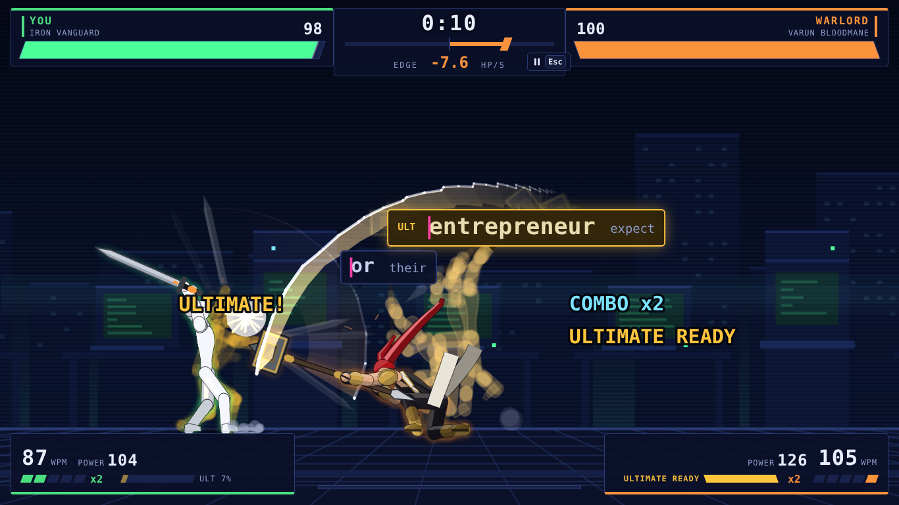
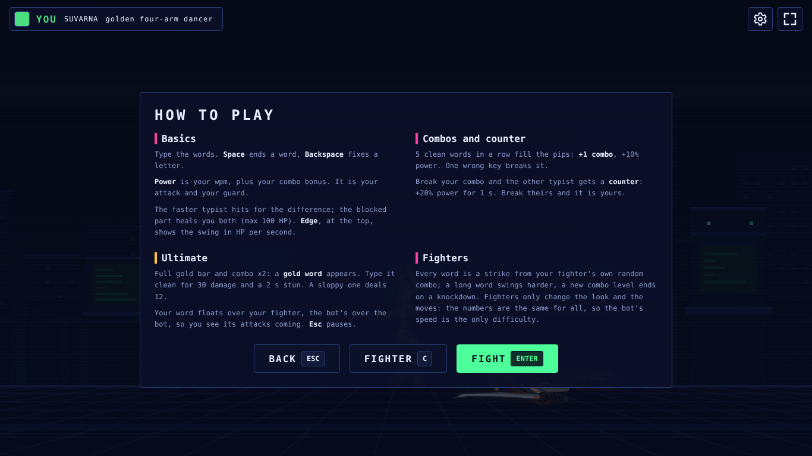
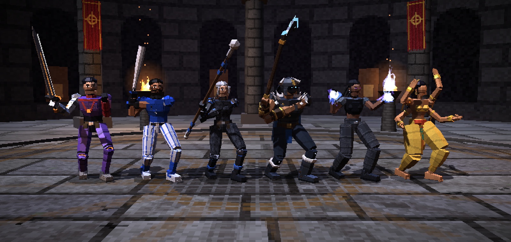

# Type Boxing

A real time 1v1 typing fighting game for desktop browsers. Two typists race through an endless stream of words beneath a fighting arena, and typing speed is both your attack and your guard. Type faster than your opponent and you deal damage; type cleanly and you build combos; hold a long enough combo and a gold ultimate word appears.

Built in plain HTML, CSS and JavaScript with no framework and no build step. The game itself uses no libraries; only the 3D Lab uses three.js (bundled in `js/vendor`). Open `index.html` and play.

> Status (October 2026): the single player duel against bots is complete and tested. Eleven designed 2D fighters (faceless, masks kept) fight in the game with random combos and synthesized sound effects; the Animation Lab is their test page, and a separate 3D Lab (three.js) explores a 3D direction. Online multiplayer is planned next.



| Mid fight | Ultimate |
|---|---|
|  |  |
| **Result screen** | **3D Lab lineup** |
|  |  |

---

## Contents

1. [Quick start](#quick-start)
2. [How to play](#how-to-play)
3. [Game rules](#game-rules)
4. [Fighters](#fighters)
5. [Bots](#bots)
6. [Characters (Animation Lab)](#characters-animation-lab)
7. [Project structure](#project-structure)
8. [Architecture](#architecture)
9. [Design system](#design-system)
10. [Testing](#testing)
11. [Roadmap](#roadmap)
12. [Decisions on record](#decisions-on-record)
13. [Contributing](#contributing)
14. [Credits and inspiration](#credits-and-inspiration)

---

## Quick start

No install is needed to play.

1. Clone or download this repository.
2. Double click `index.html` (or open it in Chrome, Edge or Firefox).
3. Press Enter to fight the selected bot.

Other pages:

| Page | What it is |
|---|---|
| `index.html` | The game: the duel against a bot |
| `animations.html` | The Animation Lab, a test page for the eleven designed fighters and their random combos |
| `lab3d.html` | The 3D Lab: six characters in three.js, with move lists and a training dummy |
| `sandbox.html` | The original combo sandbox (an early prototype, kept for reference) |

Optional, for running the rule and balance tests: install [Node.js](https://nodejs.org) (LTS), then run `node tests/duel-sim.js` from the project folder.

---

## How to play

Words scroll for each player. Type them the way you would on Monkeytype: space ends a word, a wrong letter still moves the caret forward, and backspace fixes letters in the current word.

- **Your speed is your power.** Power drives both attack and defense. Only the faster typist deals damage, and only the difference.
- **Clean words build combos.** A word with no wrong keystroke counts as clean, even if you fixed it. Each run of clean words raises your combo level and your power.
- **Mistakes give your opponent an opening.** A typo while you hold a combo resets it and gives the other typist a short counter window.
- **Charge the ultimate.** Typing fills the gold bar. With a full bar and enough combo, a gold word appears. Type it cleanly for a big unblockable hit and a stun.

### Views

- **Over-head (default):** each typist's current word floats above their own fighter, so you can see the opponent's attack coming.
- **Classic:** a Monkeytype style typing box at the bottom of the screen.

Switch with F2 on the title or result screen, or in Settings.

### Controls

Every action has both a key and a clickable button. Clicks never steal focus from typing.

| Where | Keys |
|---|---|
| Title | Enter play, 1 to 7 pick a bot, C fighter, H how to play, S settings, F2 view, F fullscreen |
| Fighter screen | Arrow keys to choose one of the 11 fighters, Enter confirm, Esc back |
| In a fight | Type. Esc pauses |
| Pause | Esc or Enter resume, R restart, S settings, Q quit |
| Result | Enter rematch, 1 to 7 change bot, Esc menu |

Settings has four tabs: Game (view, damage numbers), Video (reduce motion, screen shake, fullscreen), Audio (sound on or off, volume) and Controls (key reference). Settings, your fighter and match history are saved in the browser's local storage.

---

## Game rules

All numbers live in `CONFIG.duel` in `js/config.js`.

| Rule | Detail |
|---|---|
| WPM | Correct keystrokes over the last 4 seconds (5 characters = 1 word) |
| Power | wpm x (1 + 10% x combo level), x1.20 during a counter window. A stunned typist has 0 power |
| Damage | Per second: 0.35 x (your power minus their power), only when positive |
| Blocking and healing | The matched part of both powers is blocked. Both players heal 0.04 HP per blocked wpm per second, capped at 100 HP |
| Combo | Every 5 clean words in a row adds a level, up to 5. Any mistake resets the streak |
| Counter | A mistake at combo level 1 or higher gives the opponent x1.20 power for 1 second. It refreshes, never stacks |
| Ultimate | The bar charges with typing speed (about 10 seconds at 60 wpm); mistakes drain it. At full charge and combo x2, a gold word is inserted. Clean: 30 unblockable damage and a 2 second stun. Sloppy: 12 damage |
| Win | First fighter to 0 HP loses |

The duel is deterministic: it runs on a fixed 1/120 second step from a seed, and nothing in the rules reads the real clock or `Math.random`. This keeps it ready for peer to peer multiplayer.

---

## Fighters

Pick one of eleven fighters on the Fighter screen: Iron Vanguard, Blue X, Commander Voss, Frostjaw, Nova, Suvarna, Crimson Veil, Ronin Unit, Scarlet Reaver, Varun Bloodmane and Grin. Every finished word is a strike from your fighter's own random combo (a long word swings harder, a new combo level ends on a knockdown, the ultimate is a fast run of every attack). When your power beats the opponent's the hit lands, otherwise they parry. Fighters only change the look and the moves: everyone plays by the same numbers, so the bot's speed is the only difficulty.

---

## Bots

Six evenly spaced bots plus MATCH ME, so every player has a close fight. Each card shows an honest "beat it at about N wpm" number, verified over hundreds of simulated matches per bot (target: 45% to 55% win rate at that speed).

| # | Bot | Personality | Fighter | Beat it at about |
|---|---|---|---|---|
| 1 | ROOKIE | Careful and slow | Blue X | 30 wpm |
| 2 | SCRAPPER | Sloppy brawler | Grin | 45 wpm |
| 3 | TECHNICIAN | Steady combo builder | Commander Voss | 60 wpm |
| 4 | DUELIST | Balanced all-rounder | Ronin Unit | 75 wpm |
| 5 | BERSERKER | Fast, wild bursts | Scarlet Reaver | 90 wpm |
| 6 | WARLORD | Heavy-hitting boss | Varun Bloodmane | 110 wpm |
| 7 | MATCH ME | Your average over your last 3 matches | Crimson Veil | Your average |

---

## Characters (Animation Lab)

`animations.html` is a test page. It holds the eleven original fighters the game uses rebuilt as side view vector puppets from concept art, with their own proportions, costumes, weapons, move sets, effects and sounds. The art direction is inspired by the look of late 1990s 3D fighting games: realistic proportions and faceted shading from a single light, with no comic outlines.

| Key | Name (working) | Concept | Weapon |
|---|---|---|---|
| 1 | IRON VANGUARD | Cyborg swordsman | Cyber sword |
| 2 | BLUE X | Baseball brawler | Metal bat |
| 3 | COMMANDER VOSS | Armored staff fighter | Long staff |
| 4 | FROSTJAW | Ice barbarian (heavy) | Greataxe |
| 5 | NOVA | Blue flame brawler | Floating spell orb of blue fire |
| 6 | SUVARNA | Faceless golden four-armed dancer | Four palms |
| 7 | CRIMSON VEIL | Masked whip duelist | Braided whip (sword moves) |
| 8 | RONIN UNIT | Cloaked cyborg swordsman, visor mask | Katana |
| 9 | SCARLET REAVER | Axe berserker | Red crescent axe |
| 0 | VARUN BLOODMANE | Hammer warrior | Gold war hammer |
| - | GRIN | Smiley-mask gunman | Two pistols (bare-hand moves) |

Every fighter is faceless; masks and helmets are kept.

What the lab includes: procedural walk, run, crouch, jump, dash, skid and turn with planted feet and two-bone IK; separate male and female bodies and movement styles; attacks that chain through cancel windows; air and running attacks; hit, stagger and knockdown reactions; idle breaks; follow-through springs, smears, impact frames, hit-stop and synthesized sound.

Lab keys: 1 to 9, 0 and - pick a fighter, G plays a random combo (Shift+G replays it), arrows move (Shift to run, double tap to dash), Space jump, A S D F attacks, Q combo, E parry, T taunt, X lock-on toggle, Z slow motion, P pause, V animation sheets, Enter demo reel, U sound.

**Rule:** the character designs must not be altered. Animations are finalized in the lab before they move into the game.

---

### 3D Lab

`lab3d.html` rebuilds six of the characters in 3D with three.js: a shared skeleton with blendable poses and inverse kinematics (`t3-core.js`), character models (`t3-models.js`), a stage (`t3-scene.js`), and one move list per character in `js/moves/`. You fight a training dummy with guard modes, hit-stop, sparks, camera shake, a combo counter and sound. The on-screen help panel lists the keys.

---

## Project structure

```
index.html            The duel (main game)
animations.html       Animation Lab (test page)
sandbox.html          Original combo sandbox (legacy)
lab3d.html            3D Lab (three.js test page)
docs/screenshots/     Images used in this README

css/
  duel.css            Game UI and HUD
  anim-lab.css        Animation Lab UI
  lab3d.css           3D Lab UI
  style.css           Sandbox UI

js/
  config.js           All tunable numbers, theme, the one rule set, bots, fighters, settings
  words.js            Word pools and the seeded word source
  duel-typing.js      Typing engine, Typist (wpm, combo, charge), Bot
  duel.js             The rules and the world. No keyboard, no DOM
  fighter.js          Position and animation state of one fighter
  render.js           Canvas drawing. Never changes game state
  main.js             Input, screens, HUD, menus, settings, layout
  duel-chars.js       The 2D fighters in the game, driven by the duel (visual only)
  sfx.js              Synthesized sound effects (Web Audio)

  anim-rig.js         Lab: skeleton and drawing
  anim-move.js        Lab: character controller and procedural locomotion
  anim-clips.js       Lab: attack and reaction clips
  anim-chars.js       Lab and game: the eleven designed fighters
  anim-combos.js      Lab and game: seeded random combos (Combo2D)
  anim-lab.js         Lab: stage, effects, keys

  t3-core.js          3D Lab: skeleton, poses, blending, IK
  t3-models.js        3D Lab: character models
  t3-scene.js         3D Lab: stage, lights, camera
  t3-moves.js         3D Lab: move system
  t3-fighter.js       3D Lab: fighter controller
  t3-lab.js           3D Lab: test stage, HUD, keys
  moves/              3D Lab: shared animation makers and one move list per character
  vendor/three.min.js three.js (MIT, see three.LICENSE.txt)

  sandbox.js, sim.js, typing.js   Sandbox only (legacy)
  game.js             Empty stub, safe to delete

tests/
  duel-sim.js         Headless rule checks and balance simulator
```

---

## Architecture

The code keeps rules, rendering and input strictly apart, so a network layer can replace the bot later without touching the rules.

```
 keyboard / mouse ──> main.js ──events──> Duel.handleEvents(side, events, time)
        Bot ────────> main.js ──events──┘          │
                                                   v
                                     duel.js (rules, fixed 1/120 s step)
                                                   │ read only
                                                   v
                                     render.js (canvas) + main.js (HUD, DOM)
```

Rules that keep it multiplayer ready:

- Both typists send the same kind of events into `Duel.handleEvents`. The duel never creates or steps a typist.
- `Duel.start(seed)`: a shared seed gives both peers identical word streams. The fighter keys are cosmetic and travel with it.
- The duel never reads the keyboard, the real clock or `Math.random`. A test enforces this.
- Pause, hit-stop and all visual settings live outside the rules and never change an outcome.

Tech choices: classic `<script>` tags (not ES modules) so the game runs by double clicking `index.html`; canvas for the arena, DOM for the HUD and menus; no libraries in the game except PeerJS, planned for multiplayer. The 3D Lab uses three.js.

---

## Design system

Theme: **Terminal Arcade**, a retro computer lab and arcade cabinet world. Defined once in `THEME` at the top of `js/config.js` and mirrored as CSS variables.

| Token | Hex | Meaning |
|---|---|---|
| bg | `#060a18` | Page and sky |
| surface | `#0b1129` | Panels and cards |
| text | `#e8edff` | Main text |
| phosphor | `#4dff9a` | Logo, wins, healthy HP |
| magenta | `#ff3ea5` | Focus, selection, caret, counter |
| gold | `#ffc53d` | The ultimate only |
| danger | `#ff4d5e` | Typos, critical HP, K.O. |

- Every text color meets at least 4.5:1 contrast, measured.
- One monospace font family, a fixed type scale (12, 16, 24, 32, 64) and an 8 px spacing grid.
- Full screen layout inspired by modern browser shooters: the arena fills the window at any aspect ratio, with a versus style HUD (health bars at the top, clock and "edge" meter in the middle, stats in the bottom corners).
- Reduce motion is respected throughout.

---

## Testing

Every change is tested before it is called done.

- **Rules and balance:** `node tests/duel-sim.js` runs rule checks, the bot calibration table and the beat-at check (a few minutes). `node tests/duel-sim.js 0 0` runs only the rule checks in about a second. Run it after any rule or balance change.
- **Game in a real browser:** Playwright in headless Chromium opens the page, presses real keys, reads game state and takes screenshots at several resolutions. Pass criteria: zero console errors and frame time under about 1 ms.
- **Animation Lab:** `window.labRun(steps, input)` drives the real controller with scripted input. Scripted checks run every scenario on all six characters and measure NaN pose values, feet going through the floor, joint jumps per step and planted foot slide. Lineup renders are compared with the concept art.

---

## Roadmap

Done:

1. Combo sandbox
2. Duel against a bot
3. Words over the fighters (Over-head and Classic views)
4. Fighter color customization
5. Weapon tiers (later removed: one rule set, bot speed is the only difficulty)
6. Terminal Arcade look, parallax arena, fighting game HUD
7. Full screen layout, mouse support, pause and settings, calibrated bots and MATCH ME
8. Animation Lab: six designed characters, procedural movement, restyle pass, Nova's spell orb, Suvarna's four arms
9. Eleven faceless 2D fighters in the game, random combos, sound effects

Next:

- Adjust the character art direction once reference images are shared, and confirm each character's body type
- More four-arm moves; possibly a three-quarter view
- Playtest attack pacing at slow and fast typing speeds
- Game modes
- Online multiplayer with PeerJS (peer to peer, room codes)
- Delete `js/game.js`

---

## Decisions on record

- Your own word appears above your own fighter, not above the enemy.
- Breaking a combo rewards the opponent with a counter window.
- Theme is Terminal Arcade; layout is full screen with a versus style HUD.
- One rule set for everyone; the bot's speed is the only difficulty. Fighters are cosmetic.
- Characters are vector rebuilds of the concept art; designs are never altered; the dancer has four real arms.
- Image files (sprite sheets, references) are allowed in the project.
- No libraries without discussion, except PeerJS for multiplayer and three.js for the 3D Lab.

---

## Contributing

1. Work in small steps. After each step, write down how to test it in the browser.
2. Keep rules (`duel.js`, `duel-typing.js`) separate from rendering (`render.js`) and input (`main.js`).
3. Put every tunable number in `js/config.js`, never inline.
4. Prefer simple code over clever code.
5. Run `node tests/duel-sim.js` after any rule or balance change, and check the browser console shows zero errors.
6. Do not change the character designs.

Writing style for docs and in-game text: plain, concise prose; no em dashes or en dashes.

---

## Credits and inspiration

- Created by Krishna as a portfolio project and a stepping stone toward a larger 3D multiplayer weapon fighting game.
- Genre inspiration: "Keyboard Warrior Stickman: Typing Beat Em Up". Only the idea of a typing beat 'em up was borrowed; no art, characters, names, stages or music.
- Word stream feel inspired by Monkeytype. UI layout patterns inspired by Krunker.io. Character art direction inspired by late 1990s 3D fighting games. All art, characters and code in this repository are original.
